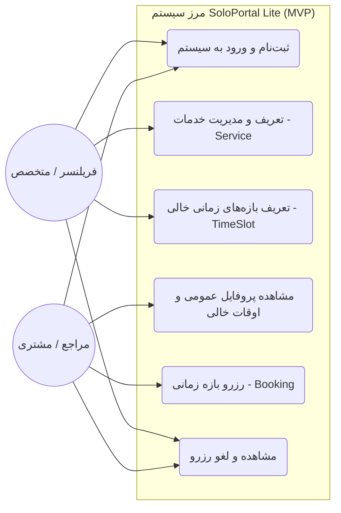
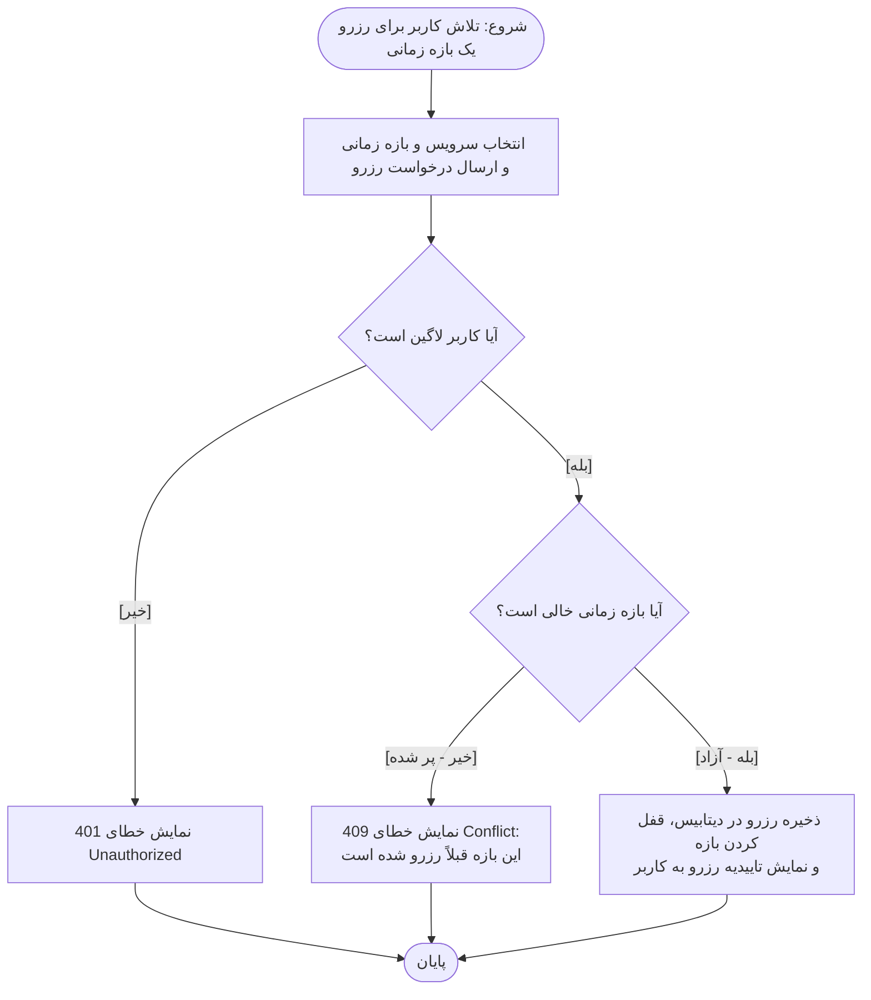
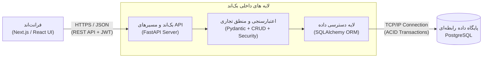
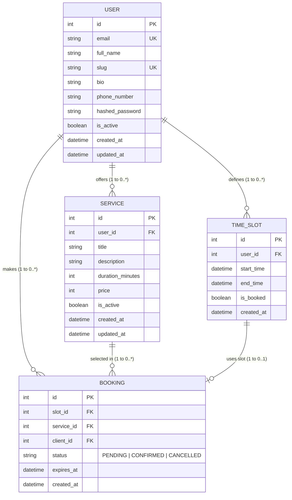

# SoloPortal Lite 📅💳

A lightweight, streamlined booking and scheduling platform designed for freelancers, consultants, and independent professionals.

**خلاصه:** هدف این پروژه، ساده‌سازی فرایند رزرو وقت و مدیریت جلسات برای فریلنسرها و مشاوران مستقل است تا بدون درگیری با هماهنگی‌های دستی و پیام‌های رفت‌وبرگشتی طولانی در شبکه‌های اجتماعی، جلسات خود را مدیریت کنند.

🔗 **لینک پیش‌نمونه کلیک‌پذیر (Clickable Prototype):** `[لینک Vercel یا Figma خود را اینجا قرار دهید]`  
🔗 **لینک نسخه مستقر شده (Live Demo - HTTPS):** `[در فاز نهایی قرار می‌گیرد]`

---

## 📌 ۱. تعریف مسئله و محدوده پروژه (Problem Statement & Scope)

متخصصان مستقل، مشاوران و فریلنسرها برای هماهنگی جلسات با مراجعان خود زمان زیادی را صرف پاسخگویی به پیام‌های تکراری، بررسی تقویم و جلوگیری از تداخل جلسات می‌کنند.  
**SoloPortal Lite** یک پورتال شخصی به هر فریلنسر (با آدرس اختصاصی `/users/{slug}`) می‌دهد تا خدمات (`Service`) و بازه‌های زمانی خالی (`TimeSlot`) خود را روی تقویم شمسی (Jalali) تعریف کند و مشتریان بتوانند به صورت آنلاین وقت جلسه را رزرو کنند. این پلتفرم با کنترل همزمانی در سطح پایگاه داده (Database-level concurrency control) و مکانیزم انقضای تنبل (`Lazy Expiration` با استفاده از `expires_at`)، مشکل رزرو دوگانه (Double-booking) را بدون نیاز به صف‌های پیچیده پس‌زمینه حل می‌کند.

### اولویت‌بندی نیازمندی‌ها با چارچوب MoSCoW

| دسته اولویت | قابلیت‌های در نظر گرفته‌شده در SoloPortal Lite |
| :--- | :--- |
| **Must-Have (باید باشد - هسته اصلی MVP)** | ۱. ثبت‌نام، ورود و خروج واقعی همراه با احراز هویت و کنترل دسترسی در بک‌اند (JWT Authentication & Authorization).<br>۲. ایجاد پروفایل عمومی فریلنسر با شناسه یکتا (`slug`) و مدیریت خدمات و تعرفه‌ها (`Service`).<br>۳. تعریف بازه‌های زمانی خالی (`TimeSlot`) توسط فریلنسر.<br>۴. مشاهده اوقات خالی و ثبت رزرو (`Booking`) توسط مشتری همراه با جلوگیری از رزرو همزمان (خطای `409 Conflict`).<br>۵. مشاهده لیست رزروها در داشبورد و امکان لغو رزرو (Cancel Booking). |
| **Should-Have (بهتر است باشد)** | ۱. مکانیزم قفل موقت بازه زمانی (`expires_at` / Lazy Expiration) هنگام ثبت رزرو.<br>۲. پشتیبانی از نمایش تقویم شمسی (Jalali Calendar) در رابط کاربری.<br>۳. شبیه‌سازی درگاه پرداخت آزمایشی (Sandbox Payment Verification). |
| **Could-Have (می‌تواند باشد)** | ۱. ویرایش مشخصات پروفایل و غیرفعال‌سازی موقت یک سرویس (`is_active`).<br>۲. فیلتر سرویس‌ها و مشاهده خلاصه وضعیت رزروها در داشبورد. |
| **Won't-Have (فعلاً نخواهد بود - خارج از محدوده ترم)** | ۱. اتصال تجاری به شاپرک و تسویه حساب بانکی واقعی.<br>۲. همگام‌سازی دوطرفه با تقویم گوگل (Google Calendar) و ساخت خودکار لینک جلسات آنلاین (Google Meet).<br>۳. ارسال پیامک/ایمیل خودکار و سیستم چت زنده. |

---

## 👥 ۲. داستان‌های کاربر و معیارهای پذیرش (User Stories & Acceptance Criteria)

### US-01: ثبت‌نام و تعریف خدمات توسط فریلنسر
> **داستان کاربر:** «به عنوان یک فریلنسر، می‌خواهم در سامانه ثبت‌نام کنم و خدمات قابل ارائه خود (عنوان، مدت زمان و تعرفه) را تعریف کنم تا مراجعان بدانند چه نوع جلساتی را می‌توانند با من رزرو کنند.»
* **معیارهای پذیرش (Acceptance Criteria):**
  1. فریلنسر می‌تواند با ایمیل و اسلاگ یکتا ثبت‌نام کند و رمز عبور او به صورت هش‌شده (`bcrypt`) در دیتابیس ذخیره می‌شود.
  2. فریلنسر می‌تواند سرویس جدید ثبت کند (`201 Created`) و سرویس‌ها پس از بارگذاری مجدد صفحه (Refresh) در پروفایل عمومی او (`/users/{slug}/services`) ماندگار و قابل مشاهده هستند.
  3. کاربران غیرمجاز یا لاگین‌نشده قادر به ثبت یا تغییر سرویس برای پروفایل دیگران نیستند (`401 Unauthorized` / `403 Forbidden`).

### US-02: تعریف بازه‌های زمانی خالی (Time Slots)
> **داستان کاربر:** «به عنوان یک فریلنسر، می‌خواهم بازه‌های زمانی آزاد خود را ثبت کنم تا مشتریان فقط در ساعات مشخص‌شده توسط من قادر به رزرو وقت باشند.»
* **معیارهای پذیرش:**
  1. بازه زمانی با تاریخ و ساعت شروع و پایان معتبر در پایگاه داده ذخیره می‌شود.
  2. ثبت بازه زمانی در ساعات نامعتبر (زمان پایان قبل از زمان شروع) یا دارای تداخل با بازه‌های قبلی همان فریلنسر توسط بک‌اند رد می‌شود (`400 Bad Request`).

### US-03: مشاهده اوقات خالی و رزرو جلسه توسط مشتری
> **داستان کاربر:** «به عنوان یک مراجع (Client)، می‌خواهم بازه‌های زمانی خالی یک فریلنسر را مشاهده کرده و یکی را رزرو کنم تا بدون نیاز به ارسال پیام‌های رفت‌وبرگشتی، وقت جلسه من ثبت شود.»
* **معیارهای پذیرش:**
  1. مراجع می‌تواند بازه‌های خالی موجود را مشاهده کرده و یکی را به همراه سرویس مورد نظر رزرو نماید.
  2. رزرو در پایگاه داده ذخیره شده و پس از بارگذاری مجدد صفحه برای مراجع و در لیست فریلنسر نمایش داده می‌شود.
  3. آن بازه زمانی برای سایر مراجعان غیرقابل انتخاب می‌گردد و در صورت تلاش همزمان برای رزرو یک بازه، خطای واضح `409 Conflict` مبنی بر پر شدن وقت نمایش داده می‌شود.

### US-04: مشاهده و لغو رزرو (Cancel Booking)
> **داستان کاربر:** «به عنوان یک کاربر لاگین‌شده، می‌خواهم بتوانم رزرو خود را مشاهده یا لغو کنم تا در صورت تغییر برنامه، بازه زمانی آزاد شود.»
* **معیارهای پذیرش:**
  1. فقط صاحب رزرو یا فریلنسر مربوطه مجاز به لغو آن رکورد است (بررسی مالکیت در بک‌اند و بازگشت خطای `403 Forbidden` برای سایرین).
  2. پس از لغو موفق، وضعیت رزرو تغییر کرده و بازه زمانی مجدداً برای رزرو در دسترس قرار می‌گیرد.

---

## 🏗 ۳. معماری نرم‌افزار و توجیه انتخاب فناوری‌ها (Architecture & Tech Stack)

این سیستم بر پایه معماری **Monolithic لایه‌بندی‌شده (Client-Server)** طراحی شده است تا ضمن سادگی در استقرار و نگهداری طی یک ترم، تفکیک وظایف (Separation of Concerns) به صورت شفاف رعایت شود:

* **فرانت‌اند (`Next.js` + `React` + `Tailwind CSS`):**
  * **ساختار و توجیه معماری:** رابط کاربری از صفحات و کامپوننت‌های قابل استفاده مجدد (Reusable Components) تشکیل شده است. فراخوانی APIها در یک لایه مجزا سازماندهی شده تا مدیریت وضعیت صفحه (State)، داده‌های فرم‌ها، توکن احراز هویت و نمایش پیام‌های خطای سرور به صورت متمرکز و یکپارچه انجام شود.
* **بک‌اند (`Python` + `FastAPI` + `SQLAlchemy 2.0` + `Pydantic`):**
  * **ساختار و توجیه معماری:** بک‌اند به ۴ لایه اصلی تفکیک شده است:
    1. **لایه مسیرهای API (`app/api/v1/endpoints`):** مدیریت درخواست‌های HTTP، احراز هویت کاربر و بررسی مجوزهای دسترسی (Authorization).
    2. **لایه اعتبارسنجی (`app/schemas`):** بررسی صحت ساختار و قوانین داده‌های ورودی و خروجی با استفاده از `Pydantic`.
    3. **لایه منطق تجاری و دسترسی داده (`app/crud` و `app/models`):** اجرای قوانین تجاری، تراکنش‌ها و ارتباط با دیتابیس از طریق ORM (`SQLAlchemy`).
    4. **لایه هسته و امنیت (`app/core`):** مدیریت متغیرهای محیطی (`Environment Variables`)، هش رمز عبور با `passlib/bcrypt` و مدیریت توکن‌های `JWT`.
* **پایگاه داده (`PostgreSQL 17` + `Alembic`):**
  * **ساختار و توجیه معماری:** استفاده از پایگاه داده رابطه‌ای PostgreSQL برای تضمین ماندگاری داده‌ها (Persistence)، پشتیبانی از تراکنش‌های ACID و قفل سطح ردیف (`SELECT FOR UPDATE`) جهت جلوگیری از Race Condition در رزروهای همزمان. نسخه‌بندی اسکیما با `Alembic` مدیریت می‌شود.

### مسیر کامل یک اقدام از رابط کاربری تا دیتابیس (Feature Trace)
1. **رابط کاربری (UI):** کاربر روی دکمه «ثبت رزرو» کلیک می‌کند؛ فرانت‌اند یک درخواست `POST /api/v1/bookings` حاوی `slot_id` و `service_id` به همراه هدر `Authorization: Bearer <token>` ارسال می‌کند.
2. **لایه امنیت و مسیر بک‌اند:** سرور بک‌اند اعتبار توکن JWT را بررسی کرده و ورودی‌ها را با اسکیمای Pydantic اعتبارسنجی می‌کند.
3. **لایه منطق و دیتابیس:** تابع CRUD وضعیت بازه زمانی را در جدول `time_slots` چک می‌کند؛ اگر خالی بود، یک رکورد در جدول `bookings` ذخیره کرده و فیلد `is_booked` بازه را `True` می‌کند.
4. **پاسخ به کلاینت:** بک‌اند پاسخ `201 Created` به همراه جزئیات رزرو را برمی‌گرداند و فرانت‌اند وضعیت صفحه را به‌روزرسانی کرده و رسید رزرو را نمایش می‌دهد.

---

## 📊 ۴. نماهای طراحی چهارگانه (System Design Diagrams)

### ۱) نمودار مورد کاربرد (UML Use Case Diagram)


### ۲) نمودار فعالیت فرآیند رزرو (UML Activity Diagram)


### ۳) نمودار معماری سیستم (System Architecture Diagram)


### ۴) مدل داده و موجودیت‌ها (Entity-Relationship Diagram - ERD)


---

## 🔌 ۵. مشخصات و قرارداد ارتباطی API (API Contract)

| عملیات / متد | مسیر (Path) | ورودی (Input) | پاسخ مورد انتظار (Output) | خطاهای محتمل |
| :--- | :--- | :--- | :--- | :--- |
| `POST` | `/api/v1/users` | اطلاعات ثبت‌نام (`UserCreate`) در بدنه JSON | اطلاعات کاربر ایجادشده (`201 Created`) | `400` ایمیل یا اسلاگ تکراری / `422` خطای اعتبارسنجی |
| `POST` | `/api/v1/auth/login` | ایمیل و رمز عبور در بدنه درخواست | توکن دسترسی JWT (`200 OK`) | `401` اطلاعات ورود نامعتبر |
| `GET` | `/api/v1/users/{slug}` | شناسه یکتای فریلنسر (`slug`) در URL | اطلاعات پروفایل عمومی فریلنسر (`200 OK`) | `404` کاربر یافت نشد |
| `POST` | `/api/v1/users/{slug}/services` | بدنه JSON (`ServiceCreate`) + توکن در Header | سرویس ایجادشده (`201 Created`) | `401` عدم لاگین / `403` عدم مالکیت پروفایل |
| `GET` | `/api/v1/users/{slug}/services` | شناسه `slug` در URL | لیست سرویس‌های فعال فریلنسر (`200 OK`) | `404` کاربر یافت نشد |
| `POST` | `/api/v1/users/{slug}/slots` | زمان شروع و پایان در بدنه JSON + توکن در Header | بازه زمانی ایجادشده (`201 Created`) | `401` عدم لاگین / `403` عدم مالکیت / `400` بازه نامعتبر |
| `GET` | `/api/v1/users/{slug}/slots` | شناسه `slug` در URL | لیست بازه‌های زمانی خالی (`200 OK`) | `404` کاربر یافت نشد |
| `POST` | `/api/v1/bookings` | شناسه بازه (`slot_id`) و سرویس (`service_id`) در JSON + توکن | شناسه و وضعیت رزرو ایجادشده (`201 Created`) | `401` عدم لاگین / `409` تداخل زمانی و پر بودن وقت |
| `GET` | `/api/v1/bookings/mine` | توکن احراز هویت در Header | آرایه‌ای از رزروهای شخص لاگین‌شده (`200 OK`) | `401` احراز هویت نامعتبر |
| `DELETE` | `/api/v1/bookings/{id}` | شناسه رزرو در URL + توکن در Header | پیام موفقیت‌آمیز بودن لغو رزرو (`200 OK`) | `403` عدم مالکیت رکورد / `404` رزرو یافت نشد |

---

## 🌐 ۶. طرح استقرار آنلاین و محدودیت‌ها (Deployment & Hosting Plan)

محصول نهایی به صورت آنلاین و تحت پروتکل امن **HTTPS** روی ساب‌دامنه‌های معتبر عمومی مستقر می‌شود:
* **فرانت‌اند (Next.js):** میزبانی روی پلتفرم **Vercel** (یا سرویس ابری مشابه) متصل به مخزن GitHub با گواهی SSL خودکار.
* **بک‌اند (FastAPI):** میزبانی روی سرویس **Render** (یا **Railway / Liara**).
* **پایگاه داده (PostgreSQL):** استفاده از سرویس دیتابیس ابری مدیریت‌شده **Neon.tech** (یا **Supabase**).
* **توجیه هزینه‌ها و محدودیت‌های پلن رایگان:** استفاده از پلن‌های رایگان (Free Tier) برای پروژه دانشگاهی هزینه زیرساخت را به صفر می‌رساند. محدودیت اصلی در پلن رایگان Render، به خواب رفتن سرور (Cold Start / Spin down) پس از ۱۵ دقیقه عدم فعالیت است که باعث می‌شود اولین درخواست پس از بیدار شدن حدود ۳۰ ثانیه زمان ببرد؛ این موضوع با فراخوانی مسیر سلامت (`/api/health`) پیش از شروع دمو مدیریت می‌شود.

---

## 🚀 ۷. راهنمای راه‌اندازی و اجرای محلی (Getting Started)

### پیش‌نیازها (Prerequisites)
* **Git**
* **PostgreSQL 17** (در حال اجرا به صورت محلی)
* **Python 3.11+** (برای اجرای بک‌اند)
* **Node.js 18+** و **npm** (برای اجرای فرانت‌اند)

### مراحل نصب و اجرا (Local Setup)

۱. **دریافت مخزن پروژه:**
```bash
git clone [https://github.com/solo-portal/soloportal-core.git](https://github.com/solo-portal/soloportal-core.git)
cd soloportal-core
```

۲. **راه‌اندازی بک‌اند و پایگاه داده:**
```bash
cd backend
python -m venv .venv
# در ویندوز:
.\.venv\Scripts\activate
# در لینوکس/مک:
# source .venv/bin/activate

pip install -r requirements.txt
```
* فایل `.env` را در پوشه `backend` بر اساس مشخصات PostgreSQL سیستم خود تنظیم کنید (`DATABASE_URL`).
* اجرای مایگریشن‌های دیتابیس و بالا آوردن سرور:
```bash
python -m alembic upgrade head
python -m uvicorn app.main:app --reload --port 8001
```
* مستندات تعاملی API (Swagger UI) در آدرس `http://127.0.0.1:8001/docs` در دسترس خواهد بود.

۳. **راه‌اندازی فرانت‌اند:**
```bash
cd ../frontend
npm install
npm run dev
```
* رابط کاربری در آدرس `http://localhost:3000` در دسترس خواهد بود.

---

## 👥 ۸. اعضای تیم و شرح مسئولیت‌ها (Team Responsibilities)

| نام و نام خانوادگی | نقش و مسئولیت‌های مهندسی در پروژه |
| :--- | :--- |
| **کسرا باقری** | **توسعه‌دهنده بک‌اند و پایگاه داده:** طراحی مدل‌های داده و ERD، پیاده‌سازی جداول و مایگریشن‌ها با PostgreSQL و Alembic، توسعه APIهای RESTful با FastAPI، پیاده‌سازی امنیت، هش رمز عبور (`bcrypt`) و احراز هویت، و نوشتن تست‌های بک‌اند[cite: 1]. |
| **میبینا شاهکلایی** | **توسعه‌دهنده فرانت‌اند و رابط کاربری:** پیاده‌سازی پروتوتایپ کلیک‌پذیر، توسعه صفحات و کامپوننت‌ها با Next.js و Tailwind CSS، مدیریت وضعیت صفحه (State) و فرم‌ها، و اتصال صفحات به APIهای بک‌اند[cite: 1, 3]. |
| **شقایق خوبکار** | **توسعه‌دهنده فرانت‌اند و رابط کاربری:** طراحی و توسعه جریان‌های کاربری (User Journeys)، پیاده‌سازی تقویم شمسی (Jalali Calendar)، طراحی فرم‌های رزرو و همکاری در بهینه‌سازی تجربه کاربری (UI/UX) و اتصال داده‌های فرانت‌اند به سرور[cite: 1, 3]. |

> *تمامی اعضای تیم در تحلیل نیازمندی‌ها، نگارش داستان‌های کاربر (MoSCoW)، طراحی دیاگرام‌های معماری و UML، یکپارچه‌سازی لایه‌ها و تست سرتاسری (E2E) سیستم مشارکت فعال و مشترک دارند[cite: 1].*